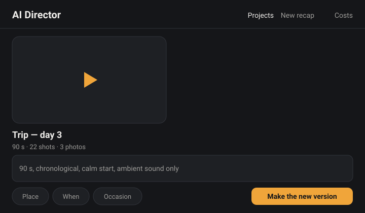

# yt-pipeline

Turn a folder of raw clips and a few words about the day into a short video.
yt-pipeline analyses the footage once, picks and cuts the shots with an AI
director, and renders a recap you can watch on your phone, open in Kdenlive or
render at full quality. Every step is a separate command, so a human or an agent
can run, inspect or re-run any one of them.



It is for people who film a lot and want a first cut without scrubbing through
every clip — and for the coding agents that help them. The web app is
phone-first: upload from the phone, write the brief, watch the recap, ask for
another version.

## Quickstart

```bash
git clone https://github.com/Dorusto/yt-pipeline && cd yt-pipeline
uv venv && uv pip install -r requirements.txt
export OPENROUTER_API_KEY=sk-or-v1-...            # key from https://openrouter.ai/keys
.venv/bin/python scripts/doctor.py --source <trip-folder>/raw
.venv/bin/python scripts/recap.py --source <trip-folder>/raw --workspace <trip-folder>/workspace \
    --brief "90 s, chronological, calm start, ambient sound only"
# -> <trip-folder>/workspace/recap_720p.mp4 (plus edit.json, shotlog.html and explain.html)
# the web app for the phone:
.venv/bin/python scripts/serve.py --workspaces <workspaces> --inbox <inbox>
```

Install per OS — `ffmpeg` + `ffprobe` first: `sudo apt install ffmpeg` (Linux),
`brew install ffmpeg` (macOS), `winget install ffmpeg` (Windows, then reopen the
shell). Python 3.11+ and `uv` everywhere (`pip install uv`). On Windows run the
commands from PowerShell with `.venv\Scripts\python.exe` and
`$env:OPENROUTER_API_KEY=...`.

## Where to go next

- Step by step, with the web app and the phone flow: [docs/guides/user-guide.md](docs/guides/user-guide.md)
- Every tool, grouped, with flags and examples: [docs/guides/tools.md](docs/guides/tools.md)
- What it costs and how to support it: [docs/guides/user-guide.md](docs/guides/user-guide.md)
- Phone-only flow (Syncthing → inbox → serve → ntfy): [docs/guides/phone-flow.md](docs/guides/phone-flow.md)
- Run a pilot host for friends: [docs/guides/pilot-host.md](docs/guides/pilot-host.md)
- Use it from an AI agent (Claude Code or opencode): [docs/AGENT_SETUP.md](docs/AGENT_SETUP.md)
- Work on the code with an AI agent: [AGENTS.md](AGENTS.md) (shared by Claude Code, opencode and DeepSeek).
- What it can and cannot do yet: [docs/ROADMAP.md](docs/ROADMAP.md)

Licensed under [AGPL-3.0-or-later](LICENSE); external contributions need a signed
CLA — see [CONTRIBUTING.md](CONTRIBUTING.md).
