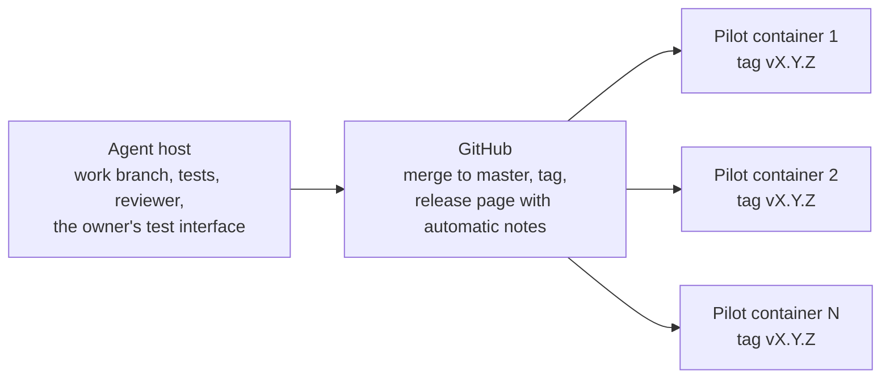

# Pilot host — one container per person, one released tag

Each person (the owner included) gets one small container running the same
released tag. A person reaches only their own container through a Tailscale
node share; the inbox and the workspaces live on a NAS share mounted into the
container. The owner sets up the Tailscale share, the NAS share, the mount and
the env file; `deploy/update.sh` does the rest.

Placeholders in this guide: `<container>`, `<nas-share>`, `<tag>`, `<repo>`,
`<tailnet-ip>`. Nothing here is a real address or a real key.

## How a version reaches people



1. **Development on the agent host.** Work happens on a branch; the tests, the
   reviewer and the owner's test interface run there.
2. **Release on GitHub.** The branch is merged to `master`, tagged `vX.Y.Z`,
   and the release page carries the automatic notes.
3. **Production on one container per person.** Every container runs the same
   tag. A release deploys to every container at once (the deploy lot);
   `deploy/update.sh` updates a container and rolls back to the previous tag
   when the smoke test fails.

A staged rollout (the owner's container first, then the others) is left for
when more people are involved.

## What the owner sets up (once per person)

1. **Container.** One small container per person, the same image, the same
   released tag. The container runs `serve.py` (the web app) and the pipeline.
2. **Tailscale node share.** Share only that container's node with the person,
   so they reach `http://<container>:8091/` and nothing else on the tailnet.
3. **NAS share.** One share per person on the NAS, mounted into the container
   at `<nas-share>`. The inbox and the workspaces live there, so the footage
   survives a container rebuild.
4. **Mount.** Mount `<nas-share>` into the container (for example at
   `/srv/yt-pipeline`).
5. **Env file.** `/etc/yt-pipeline/env` (not in the repo, no secrets in git):

   ```ini
   YT_PIPELINE_WORKSPACES=/srv/yt-pipeline/workspaces
   YT_PIPELINE_INBOX=/srv/yt-pipeline/inbox
   YT_PIPELINE_COSTS_DB=/srv/yt-pipeline/costs.db
   YT_PIPELINE_REQUESTS=/srv/yt-pipeline/requests.jsonl
   YT_PIPELINE_BIND=<tailscale-ip>
   OPENROUTER_API_KEY=<key>
   ```

6. **Service.** Copy `deploy/yt-pipeline-web.service` to
   `/etc/systemd/system/`, replace `<repo>` with the clone path, then
   `systemctl daemon-reload && systemctl enable --now yt-pipeline-web`.

## What the script does

`deploy/update.sh <tag>` updates the container to a released tag:

1. fetch the tags and check out `<tag>`;
2. install `requirements.txt` (with `requirements-constraints.txt` when it
   exists);
3. run the smoke test: `serve.py --check` and an HTTP GET of `/upload`
   expecting 200;
4. restart the `yt-pipeline-web` service.

On a failed smoke test it checks out the previous tag kept in `.deployed-tag`,
restarts the service and exits non-zero. `--dry-run` prints the steps and
changes nothing.

```bash
cd <repo>
deploy/update.sh <tag>
YT_PIPELINE_SMOKE_URL=http://<container>:8091/upload deploy/update.sh <tag>
deploy/update.sh <tag> --dry-run
```

The runner on a pilot container runs as root inside that container (the
container is the boundary), so `update.sh` can restart the service; run the
manual command as root too, without `sudo`.

## Continuous deployment

Publishing a GitHub Release (or a manual dispatch with a tag) deploys that tag
to every pilot container, one job per container on its own self-hosted runner.

1. **Runner.** Install a GitHub Actions runner on each container with its own
   label (for example `<label>` = `yt-owner`, `yt-friend-1`). The runner runs
   as root inside that container (the container is the boundary), so
   `update.sh` can restart the service.
2. **Clone path.** Set `YT_PIPELINE_PATH` in the runner's environment to the
   clone path (`<repo>`).
3. **Repository variable.** Add the label to the repository variable
   `PILOT_RUNNERS` (a JSON list, for example
   `["yt-owner","yt-friend-1"]`).
4. **Approval.** In the repository settings, require approval for workflows
   from outside collaborators.

Publishing a release (or a manual dispatch with a tag) then runs
`deploy/update.sh <tag>` on each container; the run is visible in the Actions
tab. The release also closes the open issues of the milestone named like the tag
and the milestone itself.

## Storage limit per person

Give each person a quota on their NAS share (for example 100 GB) and a
container disk size that fits the pipeline's temporary files. The upload page
and the costs page show the usage ("34 GB of 100 GB used") and warn over 80 %;
an upload that would pass the limit is refused before any byte is written. The
limit comes from `limits.storage_gb` (`--storage-gb`, else
`YT_PIPELINE_STORAGE_GB`, else the config); with none set no limit is shown.

## One OpenRouter key per instance

Each instance has its own OpenRouter key, with its own credit limit set in
OpenRouter, so one person's runs cannot spend another person's credit. The key
goes in the instance's `/etc/yt-pipeline/env` (`OPENROUTER_API_KEY`), never in
the repo. The upload page and the costs page show the key's remaining credit
("Model credit: $3.20 left of $5.00") and warn under `limits.credit_warn_usd`
(default 1.0); a key with no limit shows "no credit limit set". The costs page
of each instance shows that instance's own spend.

## Project costs on every instance

The owner's instance serves `GET /costs.json` (the totals from
`compute_totals`, the fixed-cost notes and the donation list; no requests). An
instance with `costs.project_totals_url` (`--project-totals-url`, else
`YT_PIPELINE_PROJECT_TOTALS_URL`, else the config) is a friend instance: its
Costs page shows the donation buttons, the person's own model cost to cover (the
key usage minus the donations recorded in that instance's ledger, red while some
is open), its limits, its own clips and one line saying anything paid above the
model cost goes into building the app further. Record a payment from that
person on their container with `costs.py add --kind donation`.

## Reaching the app over Tailscale

`serve.py` binds one address and refuses the wildcard. By default it picks the
primary LAN address, which a Tailscale node share cannot reach, so on a pilot
container pass the container's Tailscale address in the service unit
(`--bind <tailscale-ip>`) and set `YT_PIPELINE_SMOKE_URL` to the same address.
