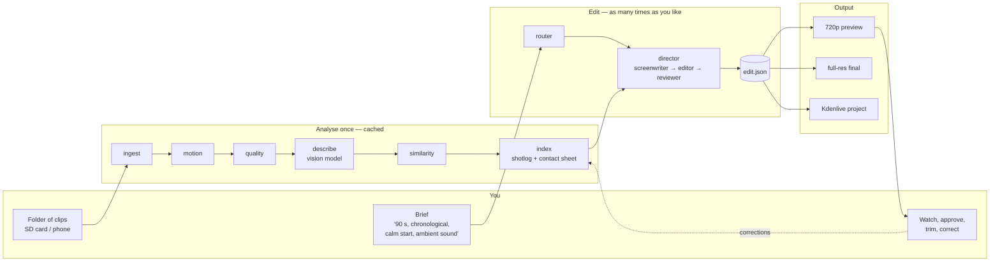

# Using the AI Director

You give it a folder of raw clips and a brief in plain words. It analyses the footage once, picks and cuts the shots, and renders a video you can watch on the phone, open in Kdenlive or render at full quality. Every step is a separate command, so a human or an agent can run, inspect or re-run any one of them.

## Quickstart

```bash
git clone https://github.com/Dorusto/yt-pipeline && cd yt-pipeline
uv venv && uv pip install -r requirements.txt
export OPENROUTER_API_KEY=sk-or-v1-...            # key from https://openrouter.ai/keys
.venv/bin/python scripts/doctor.py --source ~/media/trip/raw
.venv/bin/python scripts/recap.py --source ~/media/trip/raw --workspace ~/media/trip/workspace \
    --brief "90 s, chronological, calm start, ambient sound only"
# -> ~/media/trip/workspace/recap_720p.mp4 (plus edit.json and shotlog.html)
# full quality from the originals + a Kdenlive project:
.venv/bin/python scripts/recap.py --source ~/media/trip/raw --workspace ~/media/trip/workspace --final --brief "90 s, chronological, calm start, ambient sound only"
# re-running skips finished stations; a new brief only redoes the edit
```

The long station-by-station section below is what `recap.py` chains for you.

## The picture



Analysis runs once per folder and is cached; a new brief only re-runs the right-hand side, which takes about a minute and a few cents.

## Today (command line on the homelab)

Run everything from the repository root, `~/projects/yt-pipeline`. `WS` is the workspace folder next to the footage; the originals are never modified.

```bash
WS=~/media/trip/workspace
.venv/bin/python scripts/ingest.py ~/media/trip/proxy --workspace $WS
.venv/bin/python scripts/motion.py ~/media/trip/proxy --workspace $WS
.venv/bin/python scripts/quality.py ~/media/trip/proxy --workspace $WS
.venv/bin/python scripts/describe.py --workspace $WS          # vision model, ~2 cents per minute of footage
.venv/bin/python scripts/similarity.py --workspace $WS
.venv/bin/python scripts/index.py --workspace $WS             # shotlog.json + shotlog.html
.venv/bin/python scripts/llm_director.py --workspace $WS --brief "about 90 seconds, chronological, calm start, more energy towards the end, ambient sound only"
.venv/bin/python scripts/render.py --edit $WS/edit.json --out $WS/recap_720p.mp4
.venv/bin/python scripts/render.py --edit $WS/edit.json --out $WS/recap_final.mp4 --originals-dir ~/media/trip/raw
.venv/bin/python scripts/edit_to_fragments.py --edit $WS/edit.json --out $WS/fragments.yaml --source-dir ~/media/trip/raw --kdenlive-out $WS/recap.kdenlive
```

Every tool takes `--help` and `--json`. To review on the phone over Tailscale: `cd $WS && python3 -m http.server 8091 --bind 10.10.1.61`, then open `http://10.10.1.61:8091/shotlog.html` and the MP4.

## Writing a brief

Say what you want, not how to cut it. The router reads length, order, pacing, music and content type from it.

| You write | It does |
|---|---|
| "about 90 seconds, chronological, calm start, energy at the end" | target 90 s, shots in filming order, long holds first, shorter shots later |
| "3 minute recap, best moments first, music: ~/music/track.mp3" | ranks by score, cuts on the beats of the track |
| "tutorial, keep everything I say, chapters" | content type tutorial: silence and filler cut, chapters, graphics (D4) |

## Planned: the phone editor (D3)

```
┌────────────────────────────┐
│  Kotor boat trip      ▶ 1:32│
│  ┌──────────────────────┐  │
│  │      preview          │  │
│  └──────────────────────┘  │
│  [tunnel ★][cave ★][wake] …│  ← timeline, hero shots starred
│  ◀ trim ▶   ⟳ regenerate   │
│  ✓ approve   ✗ reject      │
│  label: travel_backward ✎  │  ← correct a label: it is remembered
│  [ Render final ]          │
└────────────────────────────┘
```

Brief in, preview out, light edits with the thumb, final render on the homelab. Kdenlive stays available for anything heavier.

## How it learns

The AI models do not change. What improves is data and rules on disk, all plain files you can read:

| What | Where | Grows by |
|---|---|---|
| Ground truth (what you say was really filmed) | `eval/*.yaml` in the repo, plus per-project corrections from the editor | one small entry per correction |
| Your approvals / rejections / trims | `<workspace>/feedback.jsonl` (append-only), summarised into a per-user profile | one line per action |
| Editing rules you asked for | `docs/guides/shot-grammar.md` and the director's rules; history in `docs/DECISIONS.md` | one rule per piece of feedback |

Sizes stay small: a correction is ~200 bytes, so 10 000 corrections are about 2 MB. No footage or frames are stored, only clip names and timecodes. See `docs/DECISIONS.md`, 2026-10-14, *Feedback storage and the rules digest*, for limits and compaction.

## Where to look

- What it can and cannot do yet: `docs/ROADMAP.md`
- Why it works this way: `docs/VISION.md`, `docs/DECISIONS.md`
- Filming tips that make the edit better: `docs/guides/shot-grammar.md`, section 4
- Known risks and how they are handled: `docs/RISKS.md`
