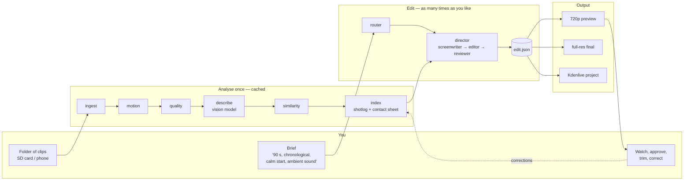

# Using the AI Director

You give it a folder of raw clips and a brief in plain words. It analyses the footage once, picks and cuts the shots, and renders a video you can watch on the phone, open in Kdenlive or render at full quality. Every step is a separate command, so a human or an agent can run, inspect or re-run any one of them.

## Quickstart

```bash
git clone https://github.com/Dorusto/yt-pipeline && cd yt-pipeline
uv venv && uv pip install -r requirements.txt
export OPENROUTER_API_KEY=sk-or-v1-...            # key from https://openrouter.ai/keys
.venv/bin/python scripts/doctor.py --source <trip-folder>/raw
.venv/bin/python scripts/recap.py --source <trip-folder>/raw --workspace <trip-folder>/workspace \
    --brief "90 s, chronological, calm start, ambient sound only"
# -> <trip-folder>/workspace/recap_720p.mp4 (plus edit.json, shotlog.html and explain.html)
# full quality from the originals + a Kdenlive project:
.venv/bin/python scripts/recap.py --source <trip-folder>/raw --workspace <trip-folder>/workspace --final --brief "90 s, chronological, calm start, ambient sound only"
# with music (auto picks a track from the music library by the brief and the shot tags; see below):
.venv/bin/python scripts/recap.py --source <trip-folder>/raw --brief "90 s, chronological" --music auto
# re-running skips finished stations; a new brief only redoes the edit
# the web app for the phone:
.venv/bin/python scripts/serve.py --workspaces <workspaces> --inbox <inbox>
```

The long station-by-station section below is what `recap.py` chains for you.

## The picture



Analysis runs once per folder and is cached; a new brief only re-runs the right-hand side, which takes about a minute and a few cents.

## Today (command line on the homelab)

Run everything from the repository root, `<repo>`. `WS` is the workspace folder next to the footage; the originals are never modified.

```bash
WS=<trip-folder>/workspace
.venv/bin/python scripts/ingest.py <trip-folder>/proxy --workspace $WS
.venv/bin/python scripts/motion.py <trip-folder>/proxy --workspace $WS
.venv/bin/python scripts/quality.py <trip-folder>/proxy --workspace $WS
.venv/bin/python scripts/describe.py --workspace $WS          # vision model, ~2 cents per minute of footage
.venv/bin/python scripts/similarity.py --workspace $WS
.venv/bin/python scripts/index.py --workspace $WS             # shotlog.json + shotlog.html
.venv/bin/python scripts/llm_director.py --workspace $WS --brief "about 90 seconds, chronological, calm start, more energy towards the end, ambient sound only"
.venv/bin/python scripts/explain.py --workspace $WS                    # explain.html: why the edit looks the way it does
.venv/bin/python scripts/render.py --edit $WS/edit.json --out $WS/recap_720p.mp4
.venv/bin/python scripts/render.py --edit $WS/edit.json --out $WS/recap_final.mp4 --originals-dir <trip-folder>/raw
.venv/bin/python scripts/edit_to_fragments.py --edit $WS/edit.json --out $WS/fragments.yaml --source-dir <trip-folder>/raw --kdenlive-out $WS/recap.kdenlive
```

Long shaky runs keep their move or hold role by default (the review policy): the vision model and the director see the shake defect and decide. `YT_PIPELINE_SHAKY=drop` restores the old behaviour that turns them into `accidental`; junk frames (obstruction, near-uniform, static low-detail) are `accidental` either way.

Every tool takes `--help` and `--json`. To review on the phone over Tailscale: `cd $WS && python3 -m http.server 8091 --bind <agent-host>`, then open `http://<agent-host>:8091/shotlog.html` and the MP4.

## Mode B on a finished clip

A talking-head recording with a screen capture (one `Start Recording` in OBS
writes both files) is a different flow from a trip recap: you film, rough-cut
the recording, finish the edit in FilmCraft and then publish. The Second Brain
clip is the reference: one dated clip folder per project (named e.g.
`2026-09-second-brain/`, and written `<trip-folder>` below) with `camera/`, `ecran/`,
`transcrieri/` (the Whisper word JSONs) and the FilmCraft `.fcproj`. The
examples below use that layout; the agent-side eval copy of the clip lives at
`<eval-folder>/second-brain`.

```bash
# 1. right after recording — is any "screen" file really a camera recording?
.venv/bin/python scripts/mode_b.py <trip-folder> --check

# 2. the whole flow on the folder (transcribe what has no words JSON, pair
#    camera and screen, rough-cut the pauses/fillers/retakes, chapters,
#    FilmCraft project):
.venv/bin/python scripts/mode_b.py <trip-folder> --json
# -> <trip-folder>/mode_b/ : sessions.yaml, edit.json,
#    chapters.json, words/, project.fcproj

# 3. finish the edit in FilmCraft (the .fcproj sits in the clip folder), then
#    from the FINAL project:
.venv/bin/python scripts/publish.py --project <trip-folder> \
  --context notes.md --fcproj project.fcproj --sequence "Second Brain - 15 min" \
  --words-dir <trip-folder>/transcrieri --chapters chapters.json \
  --photo portrait.jpg --title "..." --keyword "..." --theme tech \
  --final-video final.mp4 --kit
```

- The kit is its own tool, `publish_kit.py`, so after changing only the
  thumbnail you can rebuild it alone without re-running the chain:
  `.venv/bin/python scripts/publish_kit.py --project <trip-folder> \
  --final-video final.mp4`. It links the final video into `publish-kit/`
  (hard link, else symlink, else only its path in `studio.md`) instead of
  copying it.

- The folder is `camera/` + `ecran/` (or `screen/`), or one flat folder with
  `camera ` names. A camera pairs with the screen whose name timestamp is
  nearest (10 s tolerance); unpaired cameras run camera-only. The camera file
  carries the voice and starts about a second late, so `rough_cut.py` measures
  the camera-to-screen offset **by sound** (voice cross-correlation) and records
  it in `sessions.yaml`; a value written there by hand always wins.
- The rough cut removes dead air (pauses over 0.6 s), standalone filler words
  and restarted sentences, and every cut carries a reason. From the phone, the
  web app's **Cuts** tab writes `cut_review.yaml`; `rough_cut.py --review` keeps
  what you mark `keep`.
- The web app's **Shorts** tab (shown when the project has a
  `shorts_candidates.json`) lists every ranked candidate with its rank, span,
  duration, score, hook/payoff, title, description, reason and chapter, and a
  **layout** select to
  override `face` / `split` per candidate; the tap posts to
  `POST /<project>/shorts-candidates` and rewrites only that candidate's
  `layout` key. A camera-only session (no screen angle in `edit.json`
  `sources[]`) offers `face` only. The same policy is the **Shorts layout**
  setting on the Upload and Re-edit forms (`auto` default, `on`, `off`), also
  readable from `config.yaml` as `shorts_layout`.
- From the final FilmCraft edit, `chapters.py --fcproj` and
  `shorts_rank.py --fcproj` read the real timeline (`--words-dir` is the folder
  with one Whisper word JSON per source clip) and write `chapters.json` /
  `shorts_candidates.json` into the clip's publish folder — next to
  `publish-kit/`, not next to the `.fcproj`. `publish.py --chapters` uses the
  chapters file instead of asking the model again.
- `shorts_generator.py --words <timeline _words.json> --candidates
  shorts_candidates.json` cuts the ranked Shorts with the real word times and
  the brand look (captions above the Shorts UI, phrase-based line breaks,
  karaoke highlight). `layout: split` stacks the face over the screen for a
  face-over-screen recording. Sample frames from a synthetic clip:
  `examples/s59-shorts-frames/`.
- Exit codes. `--check`: `0` all clear, `1` a suspect screen file was found,
  `2` the check could not run completely (the face detector could not load),
  `3` a usage error (missing folder, not a folder, no camera files, bad
  `--config`). A normal run exits `0` on success, `2` when a pipeline step
  failed and `3` on a usage error; when the face detector cannot load the run
  still completes and exits `0`, but warns
  `screen check incomplete: face detector unavailable: …` and sets
  `screen_check_incomplete` in `--json`.

`scripts/matte.py` cuts a time range out of a clip into a ProRes 4444 `.mov` with
alpha (camera picture-in-picture material). Its `--ratio` default now follows the
input height — `0.25` at 1080p, `0.4` at 720p, `0.125` at 4K — with `--ratio` as
the override.

`scripts/finish_pip.py` finishes a Mode B clip in the open FilmCraft project: from
a sequence inspect JSON it finds the screen spans, mattes the camera ranges that
cover them and places the mattes as a bottom-right picture-in-picture with an
eased entry and a short anticipation exit, snapped to the span edges. Run it with
`--dry-run` first to read the plan, then with `--bridge` (or `--project` for a
headless file) to run the two steps files it writes, `finish_pip.place.jsonl` and
`finish_pip.animate.jsonl`. A re-run on a finished project prints `nothing to do`;
when the placements exist but the animate phase is missing it rewrites
`finish_pip.animate.jsonl` instead.

`scripts/colour.py` evens out the colour between recording sessions: after
finishing the edit, `colour.py --fcproj project.fcproj` measures each session's
average white balance, exposure and contrast on a few frames of the camera clips
and applies one Lumetri Basic Correction per session (temperature, tint,
exposure, contrast) to every camera clip of that session, through the headless
`filmcraft-cli`. It writes a copy (`<stem>_colour.fcproj`) unless `--in-place` is
given; `--dry-run` prints the commands first.

## Writing a brief

Say what you want, not how to cut it. The router reads length, order, pacing, music and content type from it.

| You write | It does |
|---|---|
| "about 90 seconds, chronological, calm start, energy at the end" | target 90 s, shots in filming order, long holds first, shorter shots later |
| "3 minute recap, best moments first, music: <track.mp3>" | ranks by score, cuts on the beats of the track |
| "tutorial, keep everything I say, chapters" | content type tutorial: silence and filler cut, chapters, graphics (D4) |

## The web app (phone + desktop)

`serve.py` is the app Doru uses from the phone. It is **tailnet-only** (one
bind address, never the wildcard) and it never exposes the footage beyond the
finished recap, the explanation and the contact sheet.

```bash
.venv/bin/python scripts/serve.py --workspaces <workspaces> --inbox <inbox>
# open http://<tailnet-ip>:8091/
```

- **Projects** is a grid of poster cards, one per workspace, each with the recap's poster image, the name, the status (`running` / `failed` / `done`, from `<workspace>/.run.json`), the length and the date; a running project shows its current step.
- **Upload** takes clips and photos straight from the phone browser: the files,
  a project folder name, the brief and an options form where **every field
  defaults to Auto** (length 30 s / 60 s / 90 s / 3 min, order chronological /
  best first, audio clean-up, format Auto (16:9) / 16:9 / 9:16 / both, music none / a track / auto from
  the music library, ambient level under the music, speed ramp Auto (off) / off / on, Shorts layout Auto / on / off). Clips play at normal speed unless **Speed ramp: on**, which lets the middle of long camera moves play up to 1.2x. When a long move has to be shortened, the cut is centred on its best moment (the model's pick, else the busiest second, else the middle). For a vertical version pick
  **Format: 9:16** (or **both**): the recap is cut to 720x1280 with a window
  that follows the subject (`recap_720p_9x16.mp4`). **Start** streams the files
  into `inbox/<folder>/` (allowlisted extensions, size caps, never overwrites,
  never outside the inbox) and starts `recap.py` in the background; the status
  shows on Projects.
- **A project page** has the tabs **Recap** (the player, with the recap's poster as its poster image and a strip of shot thumbnails below — tap a block to jump there and pick it; a picked block shows a bin icon (remove the shot) and a **− 1 s** / **+ 1 s** row (make it shorter or longer, within the source clip; the presses add up into one running total for the picked shot, a different shot starts a new total, and Yes submits that total) — each renders a new version from the proxies, no model call, and the old version is never edited — and the vertical 9:16 player when the format was 9:16 or both), **Director** (the chat with the director and, under it, the collapsible notebook), **Files**, **Cuts** and **Shorts**.
- **Files** lists every clip and photo of the project (from its proxies and its inbox source) with its length or "photo", its size and its state — `in the edit`, `new` (added after the last edit) or `left out`. **Add files** drops more clips and photos into the project's inbox source folder (the same consent and storage checks as the Upload page); when there are new files the tab says "N new files. They join the next edit." with a **Make a new edit** button that opens the Re-edit form. A bin icon next to a file asks "Leave out <name>?" and writes the name to `<workspace>/excluded.json`; a left-out file shows **Bring back**. Nothing is deleted from disk — every station that lists clips or photos skips the left-out names, and only a project delete removes files.
- **Re-edit** on the project page repeats the options and adds a **feedback
  box**: plain words against those short ids ("drop 0071/s2, tunnel longer").
  It re-runs only the edit and the render — the analysis is reused. The
  feedback is appended to `feedback.jsonl` in the workspace.
- **Chat with the director.** The chat sits in the **Director** tab (it is no
  longer in the Recap tab). The reviewer's objections appear in it as the
  reviewer's own sentences, each naming the shot by its number on the timeline.
  The user writes what they like and what they do not, the director answers how
  it reads the request with a cost/time estimate (one cheap model call, no new
  version), and **Make the new version** starts the re-edit with the feedback;
  no new version starts without the click. When the director cannot do what the
  user asked, it says so in plain words (what it can do instead) and the request
  is noted in the requests file as a missing tool (`type: missing_tool`), so the
  owner sees which tools the director needs next. The director's reasoning
  effort — how much hidden reasoning the model spends on every call — comes from
  `--reasoning-effort` (`low`, `medium`, `high` or `off`), else
  `director.reasoning_effort` in the config, else `medium`. From the command line:
  `.venv/bin/python scripts/llm_director.py --workspace <workspace> --interpret-feedback "drop 0071/s2, tunnel longer" --json`.
- **Versions.** Every re-edit is kept: the Recap tab has a row of chips
  (v1, v2, …), each with its own strip and the feedback that asked for it. While a run is
  going the page shows the last finished version, the step it is on, and
  refreshes by itself; a failed run says where it failed and why. A version that
  is neither the latest nor the first shows a **Delete this version** button; it
  asks once ("Delete version N? Its video and files are removed for good."),
  removes that version's folder for good and returns to the latest version. The
  latest, the first and a version while a run is going cannot be deleted.
- **Title, description and hashtags.** The Recap tab shows a box with the
  YouTube title, a 2-3 sentence description and 5-10 hashtags for the shown
  version, each with a **Copy** button. A **Rewrite** button opens the four
  fact fields (Place, When, Who is in it, Occasion) and re-runs
  `recap_meta.py --force` for the shown version, showing the cost; a field the
  brief and `brief_facts.json` did not carry is marked "Add this for a better
  title". The text comes from `recap_meta.py`, which reads `edit.json` and
  `brief_facts.json` and writes `recap_meta.json` (kept in each version):
  `.venv/bin/python scripts/recap_meta.py --workspace <workspace>`.
- **Length** takes a preset, or pick **Exact seconds…** in the same menu and type the number.
- **Costs** (top bar) is a read-only page: per project the model cost and the
  number of versions, then the ledger totals (monthly running cost, development
  total, donations and the balance) and an optional donation link. On a friend
  instance it leads with the donation buttons, then its own model cost to cover,
  then its limits, then the per-clip table ("Model cost of your clips") and one
  line saying anything paid above the model cost goes into building the app
  further; the owner's page is unchanged. It reads the
  same totals object as `costs.py totals --json`. The **Feedback and requests**
  form on the same page appends one JSON line (`date`, `type`, `text`,
  `contact`, `backed`) to the requests file; with no requests file configured
  the form is hidden.
- **Instance limits.** The Upload and Costs pages show "X GB of Y GB used" (the
  workspaces + inbox size) and warn over 80 % ("almost full"); an upload that
  would pass the limit is refused before any byte is written. The storage cap
  comes from `--storage-gb`, else `YT_PIPELINE_STORAGE_GB`, else
  `limits.storage_gb` in the config; with none set no limit is shown. The same
  pages show the model credit ("Model credit: $3.20 left of $5.00") read from
  the OpenRouter key endpoint, and warn under `limits.credit_warn_usd` (default
  1.0). When the remaining credit is under that value the Upload page also shows
  a low-credit banner above the start button, so you see it before starting a
  run that would pass the key limit.
- **Brief help.** The four fact fields (Place, When, Who is in it, Occasion)
  sit above the Brief field on the Upload and Re-edit forms. The Brief field
  has hint chips (The story or the best moment, Mood, What to leave out);
  tapping one appends its line. The grey example text is a placeholder,
  never sent.
- **Consent.** The consent checkbox only appears when the instance sets a
  consent text (`--consent-text`, else `YT_PIPELINE_CONSENT_TEXT`, else
  `web.consent_text`); then the Upload page shows it with a required "I agree"
  checkbox and refuses an upload without it.
- **Delete.** A project page has a bin icon next to the title; it asks once,
  then deletes the workspace and its inbox source. It is refused while a run
  is going. A single version can be deleted from the Recap tab the same way
  (never the latest or the first).
- **Feature switches.** `--features` (comma-separated), else
  `YT_PIPELINE_FEATURES`, else `web.features` lists the parts this instance
  shows (`upload`, `recap`, `why`, `shots`, `shorts`, `costs`, `requests`);
  with none set every part is on. A part that is off is refused with a 404,
  not just hidden.
- **Logo.** The top bar shows the instance's mark left of the app name and uses
  it as the favicon. `GET /brand` shows the three options side by side; pick one
  with `brand.logo` (default `option-1`), or `--brand-logo` /
  `YT_PIPELINE_BRAND_LOGO`.

`--music auto` picks the track from the music library by the brief's pace and
the shot tags, using the BPM and energy `beats.py` measures for every track
(`scripts/music_pick.py`, skill `yt-music-pick`).

## Music library

No tool ships with a personal music path: the library folder comes from
`--library` (`music_pick.py`) or `--music-dir` (`recap.py`, `serve.py`), else
the `YT_PIPELINE_MUSIC_LIBRARY` environment variable, else `music.library` in
the config. With none set, the tools that need the library stop with a usage
error naming those three ways. In docs and examples the folder is written
`<music-library>`. Tools only read the library — nothing is ever downloaded.

`music_pick.py --list` (with `--json` for agents) reports every track with its
path, duration, BPM and licence file status (a `<stem>.license`/`.licence`
sidecar, else the library's own `LICENSE`/`LICENCE`/`COPYING` file, else
`missing`).

## Costs ledger

`scripts/costs.py` keeps a small SQLite ledger of what the project costs and
earns: model jobs, build-agent spend, fixed monthly costs, one-off investments
and donations. It calls no model. The ledger file lives **outside the
repository**: its path comes from `--ledger`, else the `YT_PIPELINE_COSTS_DB`
environment variable, else `costs.path` in the config; with none set the tool
stops with a usage error naming those three ways (docs write `<costs.db>`).

```bash
.venv/bin/python scripts/costs.py --ledger <costs.db> add --kind donation --amount 10 --date 2026-10-01
.venv/bin/python scripts/costs.py --ledger <costs.db> import-jobs --workspaces <workspaces>
.venv/bin/python scripts/costs.py --ledger <costs.db> import-dev --from <run-spend.json>
.venv/bin/python scripts/costs.py --ledger <costs.db> import-donations --from <donations.csv>
.venv/bin/python scripts/costs.py --ledger <costs.db> totals --json
```

`import-jobs` reads each workspace's `llm_spend.json` and `import-dev` the build
agents' run-spend JSON; both are idempotent by `source`, so re-running never
duplicates a row. `import-donations --from <donations.csv>` imports donations
from a CSV export (required `date`, `amount`; optional `note`, `id`), idempotent
by `source` too, and skips a bad row with a warning. `totals --json` is the
object the web app's **Costs** page reads (through the shared
`scripts/common/costs.py`): per-kind sums, the recurring monthly cost, the fixed
total over the months since the first fixed entry and the balance (donations
minus model + dev + investments + fixed monthly × months).

The Costs page also carries the **Feedback and requests** form. It appends one
JSON line (`date`, `type`, `text`, `contact`, `backed`) to the requests file,
whose path comes from `--requests`, else `YT_PIPELINE_REQUESTS`, else
`requests.path`; with none set the form is hidden. The donation link comes from
`--donation-url`, else `YT_PIPELINE_DONATION_URL`, else `costs.donation_url`,
and the app never handles payments.

The owner instance serves `GET /costs.json` (the totals object, no notes and no
requests). An instance with `costs.project_totals_url` (`--project-totals-url`,
else `YT_PIPELINE_PROJECT_TOTALS_URL`, else the config) is a friend instance:
its Costs page leads with the donation buttons, then its own model cost to
cover, then its limits, then the per-clip table ("Model cost of your clips") and
one line saying anything paid above the model cost goes into building the app
further — it does not fetch the owner's totals and shows no donations list; the
owner's page is unchanged.

## How it learns

The AI models do not change. What improves is data and rules on disk, all plain files you can read:

| What | Where | Grows by |
|---|---|---|
| Ground truth (what you say was really filmed) | `eval/*.yaml` in the repo, plus per-project corrections from the editor | one small entry per correction |
| Your approvals / rejections / trims | `<workspace>/feedback.jsonl` (append-only), summarised into a per-user profile | one line per action |
| Editing rules you asked for | `docs/guides/shot-grammar.md` and the director's rules; history in `docs/DECISIONS.md` | one rule per piece of feedback |

Sizes stay small: a correction is ~200 bytes, so 10 000 corrections are about 2 MB. No footage or frames are stored, only clip names and timecodes. See `docs/DECISIONS.md`, 2026-10-14, *Feedback storage and the rules digest*, for limits and compaction.

The director also keeps a small **notebook** of short lessons on this instance (the file at `notebook.path`). It reads the notebook before every edit, and after each new version the web app makes one cheap model call that writes at most 3 short lessons from the feedback since the last pass. A sentence that repeats across clips (for example the sponsor line) becomes a `proposal` lesson to move it to `channel.fixed`; it moves only after the owner says yes by editing the config. The notebook holds at most 40 lessons and is shown in the **Director** tab, where a lesson can be deleted. When the notebook is full the pass asks the model once to merge overlapping lessons or remove stale ones; lessons that still do not fit wait in the file and are written as soon as there is room — nothing is dropped. At most 3 lessons wait at a time; while 3 are waiting the pass writes nothing and learns them once a lesson is removed; when some room is left it asks for fewer new lessons, so nothing is learned twice. A notebook that already holds more lessons than the limit (for example after a hand edit) makes the pass write nothing and report that it is full until a lesson is removed; no lesson is ever dropped. The project page shows them under the message **The notebook is full. Remove a lesson to make room for a new one.**, with the same delete button.

## From a coding agent

A host coding agent (Claude Code, opencode, any Agent Skills tool) can direct the
edit on its own subscription, with no OpenRouter key:

1. `yt llm_director --workspace <ws> --brief "..." --prepare` writes
   `<ws>/director/inputs.md` — the brief, the settings, the editing techniques,
   the shortlisted shots and the shapes to write.
2. The agent reads it and writes `<ws>/shot_plan.json` and `<ws>/edit.json` (the
   editor answer shape).
3. `yt llm_director --workspace <ws> --brief "..." --apply` validates both,
   repairs mechanical faults and writes the final `edit.json` with
   `meta.director.by = "agent"`.

The web app keeps the OpenRouter three-role loop.

## Pilot host

A pilot host runs one small container per person, all on the same released tag;
each person reaches only their own container through a Tailscale node share and
the inbox and workspaces live on a NAS share mounted into the container. The
owner sets up the Tailscale share, the NAS share, the mount and the env file;
`deploy/update.sh <tag>` updates the container to a released tag with a smoke
test and a rollback. The storage quota, the per-instance OpenRouter key and the
project costs URL are in [pilot-host.md](pilot-host.md).

## Where to look

- What it can and cannot do yet: `docs/ROADMAP.md`
- Why it works this way: `docs/VISION.md`, `docs/DECISIONS.md`
- Filming tips that make the edit better: `docs/guides/shot-grammar.md`, section 4
- Known risks and how they are handled: `docs/RISKS.md`
- Every tool, grouped, with flags and examples: `docs/guides/tools.md`
