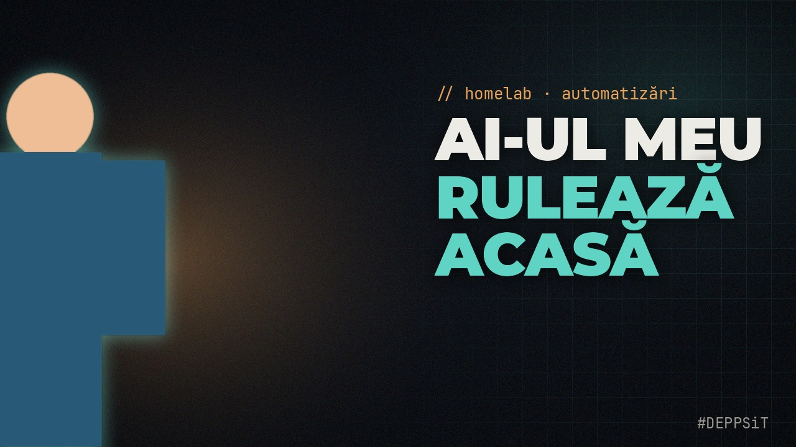
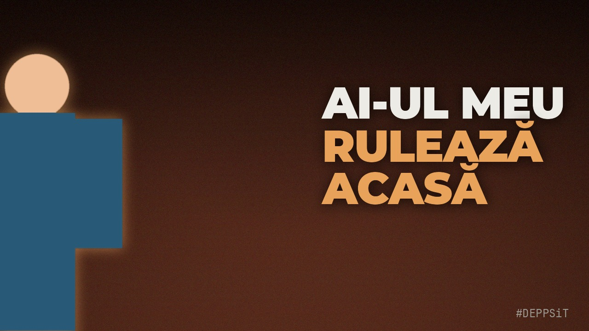

# D6-48 report — thumbnail tool + brand kit (issue #48, pulled forward from D6)

Date: 2026-10-17. Branch `d6-48-thumbnail`. Implemented by the coder from the issue
brief, audited by the architect (two audit fixes folded into the tool commit).

*(Renders from the synthetic drawn portrait — no real photo of anyone is in the repo.
More renders: `examples/thumbnail/`.)*

## Works (verified here)

- **Tool**: `scripts/thumbnail.py --photo ... --title ... --keyword ... --theme tech|creator [--background] [--psd] [--skip-cutout] [--json]` → `thumbnail.jpg` (1280x720, JPEG q92) + `thumbnail.psd`. `--help`, `--json` (with `wall_time_s`, `llm_cost_usd` 0.0), atomic writes, re-run safe (ran twice, no `.tmp` left).
- **Tests**: `tests/test_thumbnail.py` 12 passed / 1 skipped; full suite **1171 passed, 1 skipped** (134 s, no regressions). Synthetic drawn figure only — nothing human in fixtures.
- **Brand kit**: `brand.json` validates against `schemas/brand.schema.json` (schema is the interface; fonts resolve relative to the brand file; a missing font is a hard error naming path + `fonts.<key>` — tested).
- **Background**: tech recipe checked numerically against the brief formula (warm glow centre 87/71/53 vs expected 90/67/45 pre-grain, σ=5 grain explains the delta; grid alpha ramp `clip((x-560)/600,0,1)*0.10`; vignette floor 0.55 at the corners). Creator background = cover-scaled `--background` at 0.55 brightness + same vignette/grain (verified via vision + pixel means).
- **Portrait geometry** (measured from `subject_bbox_px`): subject spans y≈116.6..720, its left edge lands at x≈-106 (cut by the left and bottom frame edges), 60 px transparent margins on top/left/right kept so the glow is never clipped by the crop; glow screen-blended in its own step after the crop (cool in tech, warm in creator).
- **PSD**: reopened with psd-tools — exactly `background, portrait, title, keyword, kicker, tag` (kicker omitted when empty), document 1280x720, portrait layer at left **-144** (negative offsets survive), text layers cropped to their alpha bbox at the right canvas offsets (tag right edge 1236, baseline 690).
- **Vision audit** (GLM 5.3 Flash, both theme JPGs): text clean, nothing clipped or overlapping, diacritics (Ă) render, tech keyword teal / creator keyword warm, kicker warm in both, grid visible on the right half only (as the recipe specifies), person cut by the left/bottom edges. The only "defects" named are the cartoon test figure itself and the template's empty lower-middle area.
- **Error paths** (all exit 1 with `[error]`): `creator` without `--background`, missing font file (names the path and the brand key), invalid brand (schema), missing rembg (names `pip install rembg` and `--skip-cutout`).
- **Deps logged**: `psd-tools` 1.25.0 (MIT, active) over `pytoshop` 1.2.1 (BSD, dead since 2018); `rembg[cpu]` 2.0.85 (MIT) with `birefnet-portrait` — DECISIONS 2026-10-17, RULES "Packaging and brand (D6-48)".
- `scripts/check_public.py` ok on every new file; skill `yt-thumbnail` + README section in the same commit as the script.

## Mocked / not verified

- **The real rembg cut-out on a real photo**: the build LXC has 6 GB RAM and the OOM killer ends BiRefNet inference (exit 137) even at 450x600 input. The code calls rembg's actual 2.0.85 API (`new_session("birefnet-portrait")`, `remove`); the integration test runs it in a subprocess where the model is present and skips on OOM. First real-photo run is Doru's (below).
- PSD look inside Photoshop/Photopea — round-trip verified with psd-tools only.
- The look vs the real `DEPPSiT-template-v2` — the brief's numbers are implemented exactly, but only Doru has the template to compare against.

## Doru, check this

1. Run it once on a real photo (the one thing the LXC cannot do; needs `pip install "rembg[cpu]"` and ~8 GB free RAM):
   `python scripts/thumbnail.py --photo TU.jpg --title "AI-UL MEU" --keyword "RULEAZĂ ACASĂ" --kicker "// homelab · automatizări" --theme tech --out /tmp/thumb --psd`
2. Open `/tmp/thumb/thumbnail.psd` (or the examples above) next to `DEPPSiT-template-v2` — layout, type, glow; interpretations listed in DECISIONS 2026-10-17 (title is one line and shrinks to fit; kicker stays warm in both themes; glow is baked inside the PSD `portrait` layer). Say which to flip.
3. PSD text is rasterized (psd-tools) — layers move but type is not editable. OK, or do you want editable text layers (needs a different writer/export path)?
4. `assets/fonts/` ships Montserrat Black + JetBrains Mono (SIL OFL + licence files) so a fresh clone renders offline — keep, or point `brand.json` at your system fonts and drop the files?
5. Examples for both themes are committed under `examples/thumbnail/` (synthetic figure, safe for the public repo) — the report links them; delete the folder if you do not want generated images in git.
